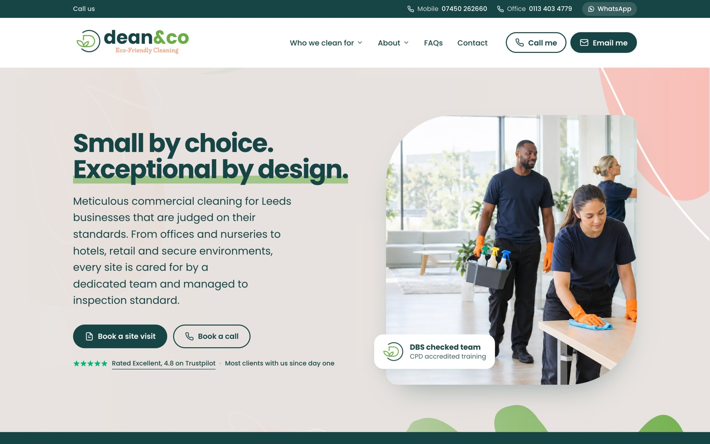

# Dean & Co Cleaning Services

The website for **Dean & Co Cleaning Services Ltd**, a founder led, eco friendly commercial cleaning company based in Leeds.

**Live site:** [www.deancocleaning.co.uk](https://www.deancocleaning.co.uk)



The site tells potential clients what Dean & Co does, who they clean for (schools, offices, receptions, hospitality, hotels and salons), how they work, and how to get a quote. It also sells the Green Bear starter kit of eco cleaning products and links to the group's two sister businesses, Emergency Cleaning Yorkshire and The Emergency Cleaning Academy.

## Tech stack

| | |
|---|---|
| Framework | [Next.js](https://nextjs.org/) 13 (Pages Router), React 18 |
| Styling | One global stylesheet (`styles/site.css`) with self-hosted Poppins fonts |
| Forms | Quote form posts to [Formspree](https://formspree.io/), which emails each enquiry to the business |
| Hosting | [Netlify](https://www.netlify.com/), using `@netlify/plugin-nextjs` |

Every page is static: there's no database, no API routes and no server-side data fetching. All content lives in the code.

## Getting started

You'll need [Node.js](https://nodejs.org/) 18 or newer.

```bash
npm install
npm run dev
```

Then open [http://localhost:3000](http://localhost:3000).

| Command | What it does |
|---|---|
| `npm run dev` | Starts the development server with live reload |
| `npm run build` | Creates a production build |
| `npm run start` | Serves the production build locally |

## Pages

| URL | Page |
|---|---|
| `/` | Home |
| `/who-we-clean-for` | Sectors (education, offices, receptions, hospitality, hotels, salons) |
| `/residential-referrals-tenancies` | End of tenancy, void and insurance referred cleaning |
| `/about` | About us |
| `/starter-kit` | Green Bear starter kit |
| `/team` | Meet the team |
| `/references` | Client references |
| `/eco-approach` | Our eco approach |
| `/compliance` | Compliance and accreditations |
| `/careers` | Careers |
| `/faqs` | FAQs |
| `/contact` | Contact details and quote form |
| `/privacy-policy`, `/cookie-policy`, `/website-terms`, `/complaints-procedure`, `/accessibility` | Legal pages |

Old `.html` addresses (for example `/about.html`) permanently redirect to the clean URLs. The list is in `next.config.js`.

## Project structure

```
components/     Shared layout and reusable sections
  Layout.js       Wraps every page: header, footer, mobile bar, cookie banner, scroll animations
  Header.js       Top contact bar, desktop dropdown menus and the mobile menu
  Footer.js       Footer links, sister businesses and company details
  site.js         Phone numbers, emails, address and menu links (edit contact details here)
  sectors.js      Text and images for each sector
  QuoteForm.js    The contact page quote form
  ...             Page header, buttons, logo strip and other reusable sections
pages/          One file per page; the file name is the URL
public/
  assets/         Images, logos and fonts
  robots.txt
  sitemap.xml
styles/
  site.css        All site styles
  fonts.css       Poppins font definitions
```

## Common edits

| To change... | Edit |
|---|---|
| Phone numbers, booking email, address or menu links | `components/site.js` |
| Sector descriptions (used on the homepage and Who we clean for) | `components/sectors.js` |
| Team members | `pages/team.js` |
| FAQs | `pages/faqs.js` (each answer is written twice: plain text for Google and the version shown on the page, so update both) |
| Client logos in the "Trusted by" strip | `components/LogoStrip.js` |
| Where quote form enquiries are sent | `FORMSPREE_ENDPOINT` in `components/QuoteForm.js` |
| Colours, spacing and layout | `styles/site.css` |

Images are pre-sized `.webp` files in `public/assets/img`. Most have a smaller `-sm` version that's served to phones, so add both when replacing one.

## Deployment

The site is hosted on Netlify, which builds it from this repository with `npm run build`. Check the Netlify deploy preview on a pull request before merging it.

If you add or rename a page, also update `public/sitemap.xml`.

## Notes

- **Cookies:** only one essential cookie is set (`dc_cookie_consent`, which remembers the visitor's choice). If analytics are added later, load them in `loadAnalytics()` in `components/CookieBanner.js` so they only run after the visitor accepts, and list them in the Cookie Policy.
- **Images:** Next's image optimizer is switched off in `next.config.js` because the site uses plain `` tags with pre-sized images.
- **`public/admin`:** a leftover Netlify CMS setup from the previous version of the site. It isn't used by the current pages.
